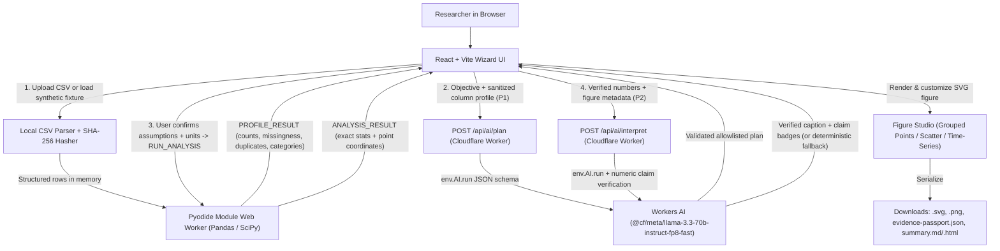

# EvidencePlot AI — Technical Spec

## How This Works, In Plain Language
EvidencePlot AI splits the work between two places so that raw research data stays private and statistical numbers are never guessed by an AI model:

1. **In the Researcher's Browser (Frontend + Local Python Worker):**
   - A **React + TypeScript** web interface handles file selection, step-by-step navigation (`1. Data` → `2. Analysis` → `3. Figure Studio` → `4. Export & Evidence`), interactive chart editing, and file downloads.
   - A dedicated **Browser Web Worker running Pyodide** (`Python` with `NumPy`, `Pandas`, and `SciPy`) runs off the main UI thread. It receives the parsed CSV rows in memory, profiles data quality, and executes fixed, vetted statistical functions (`Descriptive summaries`, `Welch's independent two-group t-test`, and `Pearson correlation`). Raw CSV rows never leave the browser.
2. **At the Cloudflare Edge (Same-Origin Worker + Workers AI):**
   - A **Cloudflare Worker** serves both the compiled static frontend assets and three lightweight JSON endpoints (`GET /api/health`, `POST /api/ai/plan`, and `POST /api/ai/interpret`).
   - When the researcher asks for AI help, the Worker calls **Cloudflare Workers AI** (`@cf/meta/llama-3.3-70b-instruct-fp8-fast`) using structured JSON schema output. For planning, it sees only the research question and sanitized column metadata; for interpretation, it sees only the verified numbers produced by Python.
   - Every response from Workers AI is checked by **Zod schemas** and a **numeric claim verifier** before reaching the screen. If AI is offline, rate-limited, returns an unverified number, or if the researcher toggles **Run without AI**, the app seamlessly uses manual method selection and a deterministic caption template.

## The Core Journey Through the System
PRD ref: `prd.md > The Core Journey`.



1. **Arrival & Dataset Selection (`prd.md > The Core Journey`, Step 1):** The user clicks **Try a sample dataset** (loading bundled `synthetic_groups.csv`, `synthetic_correlation.csv`, or `messy_example.csv`) or selects a local `.csv` file.
2. **In-Browser Parsing & Fingerprinting (`prd.md > 1. CSV Intake, Validation, and Data Profiling`):** `src/lib/csvParser.ts` checks the 5 MB / 10,000-row / 40-column guardrail, computes the file's SHA-256 hash via `crypto.subtle.digest('SHA-256', arrayBuffer)`, parses rows (handling UTF-8 BOM and quoted fields), and posts a `PROFILE` message to the local Python worker (with an instant TypeScript mirror profiler so profiling is immediate even while Pyodide warms up).
3. **Inspection & Confirmation (`prd.md > 1. CSV Intake, Validation, and Data Profiling`):** The UI displays the 10-row preview, missing/duplicate/coercion flags, identifier redaction warnings, and opt-in normalization checkboxes (trim/normalize category whitespace, complete-case filtering). The user confirms target columns, units, and independent observations.
4. **Objective & Plan (`prd.md > 2. Research Objective, AI Planning, and Assumption Confirmation`):** The user enters their research objective and either clicks **Propose analysis plan**—sending a `POST /api/ai/plan` request with sanitized column metadata (`P1`) validated against `schemas/analysis-plan.schema.json`—or selects **Run without AI** to pick from the allowlist manually. The user checks required assumption boxes and clicks **Confirm analysis**.
5. **Deterministic Python Calculation (`prd.md > 3. Deterministic Statistical Engine & Safeguards`):** The UI sends `RUN_ANALYSIS` to `src/workers/analysis.worker.ts`. Inside the worker, `src/python/engine.py` runs `SciPy` (`ttest_ind(..., equal_var=False)` with `Group B minus Group A` sign convention, or `pearsonr`) and returns `ANALYSIS_RESULT` matching `schemas/analysis-result.schema.json` along with the exact raw point coordinates.
6. **Figure Studio Rendering & Editing (`prd.md > 4. Figure Studio & Interactive Customization`):** `src/components/FigureCanvas.tsx` renders an interactive, deterministic `<svg>` chart plotting every raw observation (`data-sample-id`, `data-value`), group means/summaries, axis labels, and units. Edits to title, labels, units, safe bounds, palette, or point display update the SVG state immediately.
7. **Grounded Interpretation & Export (`prd.md > 5. Grounded Interpretation, Figure Evidence Passport & Exports`):** The UI sends `POST /api/ai/interpret` with only the verified `analysis_result` and figure metadata (`P2`). The Worker validates the LLM output against `schemas/interpretation.schema.json` and verifies that every entry in `verified_claims` matches `analysis_result.numbers` within rounding tolerance (`1e-4`); otherwise it falls back to the deterministic caption generator (`src/lib/deterministicCaption.ts`). Clicking download buttons exports the `.svg`, high-DPI `.png`, `evidence-passport.json`, and `.md`/`.html` report.

## Stack
- **Frontend Framework:** **React 19 + Vite + TypeScript (strict mode)**
  - Docs: https://developers.cloudflare.com/workers/framework-guides/web-apps/react/ and https://vite.dev/guide/
  - Rationale: Fast HMR, strict static typing across UI/Worker/Python boundaries, and native integration with Cloudflare Workers Static Assets.
- **Styling:** **Tailwind CSS** (configured with the custom scientific palette and tabular numeral utilities)
  - Docs: https://tailwindcss.com/docs
  - Rationale: Rapidly implements the calm scientific aesthetic (`#F7F9FB` canvas, `#142F50` navy, `#087F73` verified teal, `#E7B84A` gold CTA) and responsive 360px/768px/1440px breakpoints without external CSS framework bloat.
- **Edge Runtime & Hosting:** **Cloudflare Workers (Static Assets + API routes)** via **Wrangler**
  - Docs: https://developers.cloudflare.com/workers/static-assets/
  - Rationale: Serves the React SPA and `/api/*` endpoints from a single same-origin deployment with zero CORS complexity and no separate backend server to manage.
- **AI Inference:** **Cloudflare Workers AI** (`env.AI.run`) with primary model `@cf/meta/llama-3.3-70b-instruct-fp8-fast` and Structured JSON Mode (`response_format: { type: 'json_schema', ... }`)
  - Docs: https://developers.cloudflare.com/workers-ai/get-started/workers-wrangler/ and https://developers.cloudflare.com/workers-ai/features/json-mode/
  - Rationale: Server-side binding keeps credentials out of the browser and fits within the free daily neuron allocation when rate-limited to explicit user actions.
- **Scientific Compute Engine:** **Pyodide (v0.27.x pinned CDN release)** in a browser **Module Web Worker** with **`numpy`**, **`pandas`**, and **`scipy`**
  - Docs: https://pyodide.org/en/stable/usage/webworker.html and https://pyodide.org/en/stable/usage/packages-in-pyodide.html
  - Rationale: Executes genuine Python/SciPy statistical functions in the browser so calculations are 100% deterministic, private, and free of paid server-side container costs.
- **Schema & Contract Validation:** **Zod**
  - Docs: https://zod.dev/
  - Rationale: Runtime validation for every Worker request, Workers AI JSON response, and Python engine output (`schemas/*.schema.json`).
- **Chart Rendering & Export:** **Deterministic React SVG Chart Renderer + HTML5 Canvas PNG Serializer**
  - Docs: https://developer.mozilla.org/en-US/docs/Web/SVG and https://developer.mozilla.org/en-US/docs/Web/API/Canvas_API
  - Rationale: Guarantees every individual source observation is rendered without silent aggregation, keeps bundle size lightweight, and produces deterministic, testable `.svg` and `.png` downloads offline or online.
- **Testing:** **Vitest** (unit, schema, and golden numerical reference tests) + browser E2E verification
  - Docs: https://vitest.dev/
  - Rationale: Fast TypeScript and scientific reference parity testing against `examples/reference_outputs.json`.

## Where It Runs and How Someone Tries It
- **Runtime Environment:**
  - **Local development:** Node.js (v20+) with Vite + Cloudflare Wrangler local dev server (`npm run dev`), plus any modern desktop or mobile browser (Chrome, Edge, Firefox, Safari) with WebAssembly/Web Worker support for Pyodide.
  - **Optional Production Deployment:** Hosted on **Cloudflare Workers** (`*.workers.dev`) using `npx wrangler deploy`, with the `AI` binding configured in `wrangler.jsonc`.
  - *(Note: Devpost submission requires a short under-3-minute demo video and a public GitHub repository; live Cloudflare deployment is an optional enhancement we will also verify so judges can try the live URL directly.)*
- **Exact Commands to Run Locally and Record the Demo:**
  ```bash
  npm install
  npm run test        # Run golden numerical & schema verification tests
  npm run dev         # Start local Vite + Cloudflare Worker server at http://localhost:5173
  ```
- **How Someone Tries It:**
  1. Open `http://localhost:5173` (or the deployed `https://evidenceplot-ai.<subdomain>.workers.dev` URL).
  2. Click **Try a sample dataset** → select **`synthetic_groups.csv`** (or upload any `.csv`).
  3. Confirm columns (`group`, `response`), units (`arbitrary units`), and independent observations in **Step 1 (Data)**.
  4. Click **Propose analysis plan** (or **Run without AI**), check the assumption confirmation box, and click **Confirm analysis** in **Step 2 (Analysis)**.
  5. Inspect the 12 plotted observations and Welch's t-test output (`t = 7.3800`, `p = 0.00002371`), customize labels in **Step 3 (Figure Studio)**, and download `.svg`, `.png`, `evidence-passport.json`, and the summary report in **Step 4 (Export & Evidence)**.

## Look and Feel
PRD ref: `prd.md > Look and Feel`, `scope.md > Inspiration & Identity`.

- **Palette & Tokens:**
  - Background canvas: `#F7F9FB`; elevated panel surface: `#FFFFFF`; borders: `#E3E9EE` (`rounded-xl` / `12–16px`).
  - Typography colors: `#10233F` primary ink, `#536579` secondary slate.
  - Brand & interactive accents: `#142F50` deep navy header/stepper active state; `#E7B84A` warm gold primary CTA button with `#10233F` bold text; `#2764A4` accessible focus ring.
  - Semantic status badges (always icon + text label): `#087F73` verified teal, `#A86710` warning amber, `#B94046` error crimson.
- **Typography & Density:** Clean sans-serif (`Inter`, system-ui) at `16px` base font size, `26–36px` headings, and `font-variant-numeric: tabular-nums` (`tabular-nums`) on all tables, statistical outputs, p-values, confidence intervals, and SHA-256 hashes. Generous padding and calm scientific tone throughout.

## Components

### 1. App Shell, Welcome Banner & 4-Step Wizard (`src/App.tsx`, `src/components/WizardHeader.tsx`, `src/components/WelcomeHero.tsx`)
Manages the top navigation bar (active dataset badge, sample dataset loader, **Run without AI** toggle, **Clear project** button), the collapsible Welcome hero banner, the 4-step progress stepper (`1. Data` → `2. Analysis` → `3. Figure Studio` → `4. Export & Evidence`), and the live breadcrumb trail.
PRD ref: `prd.md > Screens and Layout`, `prd.md > States and Boundaries`.

### 2. CSV Parser, SHA-256 Fingerprinter & Data Inspector (`src/lib/csvParser.ts`, `src/components/DataInspectorStep.tsx`)
Validates file extension and size (`<= 5 MB`, `<= 10,000 rows`, `<= 40 columns`), computes the local SHA-256 digest via Web Crypto API, parses CSV rows (supporting UTF-8 BOM and quoted fields), flags personal-identifier column names (`patient_name`, `email`, etc.) for redaction, displays the 10-row preview and column health cards, provides opt-in checkboxes for category whitespace/case normalization and complete-case filtering, and captures user confirmation of columns, units, and observation independence.
PRD ref: `prd.md > 1. CSV Intake, Validation, and Data Profiling`.

### 3. Analysis Planner & Assumption Gate (`src/components/AnalysisPlanStep.tsx`)
Provides the research objective input, sample objective chips, the privacy disclosure banner (`P1` metadata notice), the **Propose analysis plan** action (`POST /api/ai/plan`), and the **Run without AI** manual method/chart selector. Displays proposed method (`descriptive`, `welch_t`, `pearson`), chart (`grouped_points`, `scatter`, `time_series`), rationale, warnings, and required assumption checkboxes that gate the **Confirm analysis** button. Declines unsupported methods (ANOVA, logistic regression, causal inference) with clear guidance.
PRD ref: `prd.md > 2. Research Objective, AI Planning, and Assumption Confirmation`.

### 4. Pyodide Scientific Engine & Web Worker (`src/workers/analysis.worker.ts`, `src/python/engine.py`, `src/lib/scientificEngine.ts`)
Runs statistical profiling and calculations off the main thread. Loads pinned Pyodide (`v0.27.2`) and `numpy`/`pandas`/`scipy` in a module Web Worker, executing fixed vetted functions (`profile_dataset`, `run_descriptive`, `run_welch_t`, `run_pearson`) with a deterministic TypeScript IEEE-754 parity engine (`src/lib/scientificEngine.ts`) that mirrors the exact SciPy formulas (`ttest_ind(equal_var=False)` Welch-Satterthwaite `df`, `pearsonr`, `ddof=1` sample SD) for instant unit testing and fallback recovery if CDN WebAssembly is blocked. Enforces the `Group B minus Group A` sign convention and blocks inference when sample-size, group-count, or variance preconditions fail.
PRD ref: `prd.md > 3. Deterministic Statistical Engine & Safeguards`.

### 5. Figure Studio & Deterministic SVG Renderer (`src/components/FigureStudioStep.tsx`, `src/components/FigureCanvas.tsx`, `src/lib/svgExport.ts`)
Renders the interactive publication-style SVG chart (`grouped_points` showing every individual observation + group mean/CI markers, `scatter` showing raw `(x, y)` pairs, or `time_series` showing sorted time observations) alongside the 1/3 tabbed sidebar (`Figure`, `Results`, `Data checks`). Provides live controls for chart title, X/Y labels, units, safe axis bounds (warning or blocking if bounds truncate data points), color palette, and raw-point visibility. Serializes clean `.svg` and high-resolution `2x` `.png` files.
PRD ref: `prd.md > 4. Figure Studio & Interactive Customization`.

### 6. Interpretation Verifier, Evidence Passport & Exporter (`src/components/ExportEvidenceStep.tsx`, `src/lib/passport.ts`, `src/lib/deterministicCaption.ts`)
Requests grounded interpretation from `POST /api/ai/interpret` (or uses `deterministicCaption.ts` when running without AI), verifies every numeric claim against `analysis_result.numbers`, renders clickable **Verified Claims** badges that highlight and scroll to the corresponding calculation field in the expandable **Figure Evidence Passport**, and triggers verified browser downloads for `SVG`, `PNG`, `evidence-passport.json`, and the `.md`/`.html` summary report.
PRD ref: `prd.md > 5. Grounded Interpretation, Figure Evidence Passport & Exports`.

### 7. Cloudflare Worker API & Schema Guard (`worker/index.ts`, `src/lib/contracts.ts`)
Implements same-origin edge routes (`GET /api/health`, `POST /api/ai/plan`, `POST /api/ai/interpret`), enforces payload size limits (`<= 16 KB`), validates incoming payloads and outgoing `env.AI.run` JSON responses with Zod schemas matching `schemas/*.schema.json`, strips any unverified numeric claims, and returns structured error codes (`INVALID_INPUT`, `AI_UNAVAILABLE`, `AI_INVALID_RESPONSE`, `RATE_LIMITED`) so the frontend can smoothly engage deterministic fallback.
PRD ref: `prd.md > 2. Research Objective, AI Planning, and Assumption Confirmation`, `prd.md > 5. Grounded Interpretation, Figure Evidence Passport & Exports`, `prd.md > States and Boundaries`.

## Data Model
All state lives in transient browser memory (`React` state + Web Worker memory) during the active session; nothing is written to a server database, and clicking **Clear project** or closing the tab resets all state.

1. **`DatasetRecord` (`P0` — Browser Memory Only):**
   - `fileName: string`, `sha256: string`, `fileSize: number`, `rawRows: Record<string, string>[]`
   - `profile`: `{ rowCount, columnCount, duplicateRowCount, columns: ColumnProfile[] }`
   - `normalization`: `{ trimAndFoldCategories: boolean, completeCaseFilter: boolean }`
   - `confirmedConfig`: `{ groupColumn?: string, valueColumn?: string, xColumn?: string, yColumn?: string, unit: string, independentObservations: boolean, designConfirmed: boolean }`
2. **`AnalysisPlan` (`P1` — Validated against `schemas/analysis-plan.schema.json`):**
   - `analysis`: `'descriptive' | 'welch_t' | 'pearson'`
   - `chart`: `'grouped_points' | 'scatter' | 'time_series'`
   - `columns`: `{ group?: string, value?: string, x?: string, y?: string }`
   - `confidence`: `'requires_confirmation' | 'cannot_proceed'`
   - `assumptions_to_confirm: string[]`, `rationale: string`, `warnings: string[]`, `source: 'ai' | 'manual'`
3. **`AnalysisResult` (`P2` — Validated against `schemas/analysis-result.schema.json`):**
   - `analysis_id: string`, `method: 'descriptive' | 'welch_t' | 'pearson'`, `n_total: number`
   - `numbers: Record<string, number>` (e.g., `n_a`, `n_b`, `mean_a`, `mean_b`, `sd_a`, `sd_b`, `difference_b_minus_a`, `t_b_minus_a`, `df`, `p_two_sided`, `ci95_low`, `ci95_high`, or `r`, `p_two_sided`)
   - `groups?: GroupSummary[]`, `points: PlottedObservation[]` (exact source row coordinates for plotting)
   - `dropped_for_analysis: number`, `warnings: string[]`, `limitations: string[]`
   - `runtime`: `{ engine: string, scipy: string, pandas: string, numpy: string }`
4. **`InterpretationResult` (`P2` — Validated against `schemas/interpretation.schema.json`):**
   - `headline: string`, `summary: string`, `figure_caption: string`, `limitations: string[]`
   - `verified_claims: Array<{ key: string, value: number }>`, `source: 'ai' | 'deterministic_template'`, `model_id?: string`, `generated_at: string`
5. **`EvidencePassport` (`evidence-passport.json` export contract):**
   - `schema_version: '1.0'`, `source: { name, sha256, rows }`, `columns`, `handling: { missing, dropped_for_analysis, outliers_removed: 0, category_normalization }`, `method: { id, assumptions_confirmed }`, `calculation: { engine, library_versions, result }`, `figure: { kind, labels, style }`, `ai_narrative?: { source, model_id, generated_at, verified_claims }`, `limitations: string[]`

## File Structure
```
EvidencePlot-AI/
├── devpost/                                # Official Devpost Learn planning & build artifacts
│   ├── learner-profile.md                  # Personal learner context (gitignored)
│   ├── scope.md                            # Approved project scope
│   ├── prd.md                              # Approved product requirements
│   ├── spec.md                             # Approved technical specification
│   ├── checklist.md                        # Created in 5-build
│   └── app-map.html                        # Created in 5-build wrap-up
├── evidenceplot-antigravity-context/       # Reference context pack, schemas, and fixtures
├── public/
│   └── examples/                           # Bundled synthetic CSV fixtures for 1-click demo
│       ├── synthetic_groups.csv
│       ├── synthetic_correlation.csv
│       └── messy_example.csv
├── src/
│   ├── main.tsx                            # React entry point
│   ├── App.tsx                             # Top-level state & 4-step wizard controller
│   ├── index.css                           # Tailwind CSS + scientific design tokens & tabular-nums
│   ├── components/
│   │   ├── WizardHeader.tsx                # Header bar, sample switcher, AI mode toggle, Clear project
│   │   ├── WelcomeHero.tsx                 # Screen 0 hero banner, value cards, disclaimer
│   │   ├── DataInspectorStep.tsx           # Step 1: CSV upload, preview, quality flags, column/unit confirmation
│   │   ├── AnalysisPlanStep.tsx            # Step 2: Objective prompt, AI/manual plan, assumption gate
│   │   ├── FigureStudioStep.tsx            # Step 3: 2/3 chart + 1/3 Figure/Results/Data checks inspector
│   │   ├── FigureCanvas.tsx                # Deterministic SVG renderer (grouped points, scatter, time series)
│   │   └── ExportEvidenceStep.tsx          # Step 4: Grounded narrative, claim trace badges, Passport & exports
│   ├── lib/
│   │   ├── contracts.ts                    # Zod schemas & TypeScript types matching schemas/*.schema.json
│   │   ├── csvParser.ts                    # Browser CSV parser, UTF-8 BOM handling, SHA-256 hashing
│   │   ├── dataProfiler.ts                 # Column type inference, missing/duplicate/identifier/unit checks
│   │   ├── scientificEngine.ts             # Reference-parity statistical engine & precondition validator
│   │   ├── deterministicCaption.ts         # Non-AI fallback caption & limitations generator
│   │   ├── claimVerifier.ts                # Checks AI verified_claims against deterministic engine numbers
│   │   ├── passport.ts                     # Assembles evidence-passport.json and Markdown/HTML summary report
│   │   └── svgExport.ts                    # Serializes SVG and renders 2x high-DPI PNG via HTML5 Canvas
│   ├── python/
│   │   └── engine.py                       # Vetted Python/SciPy statistical functions executed in Pyodide
│   └── workers/
│       └── analysis.worker.ts              # Module Web Worker managing Pyodide lifecycle & message protocol
├── worker/
│   └── index.ts                            # Cloudflare Worker API (/api/health, /api/ai/plan, /api/ai/interpret)
├── tests/
│   ├── golden-engine.test.ts               # Verifies Welch & Pearson outputs against reference_outputs.json
│   ├── profiler-edge-cases.test.ts         # Verifies messy_example.csv, 3-group block, n<2 block, PII redaction
│   └── contracts-and-passport.test.ts      # Verifies Zod schemas, claimVerifier, and Passport JSON output
├── index.html
├── package.json
├── tsconfig.json
├── vite.config.ts
└── wrangler.jsonc                          # Cloudflare Worker + Static Assets + Workers AI binding config
```

## External Services and Dependencies
1. **Cloudflare Workers AI (`env.AI` binding)**
   - **Docs:** https://developers.cloudflare.com/workers-ai/ and https://developers.cloudflare.com/workers-ai/platform/pricing/
   - **Model ID:** `@cf/meta/llama-3.3-70b-instruct-fp8-fast`
   - **Endpoints exposed by our Worker:**
     - `GET /api/health` → `{ ok: true, service: "evidenceplot-ai", aiConfigured: boolean, version: "0.1.0" }` (zero inference cost).
     - `POST /api/ai/plan` → accepts `{ objective, dataset_profile, allowed_analyses, allowed_charts }` (`<= 16 KB` JSON); invokes `env.AI.run` with `analysis-plan.schema.json`; returns validated `AnalysisPlan`.
     - `POST /api/ai/interpret` → accepts `{ objective, analysis_result, figure }` (`<= 16 KB` JSON); invokes `env.AI.run` with `interpretation.schema.json` and verifies numeric claims; returns validated `InterpretationResult`.
   - **Keys & Auth:** Uses Cloudflare's server-side `ai: { binding: "AI" }` in `wrangler.jsonc`. No API key is ever shipped to the browser.
   - **Rate Limits & Cost:** Cloudflare Workers AI includes a free allocation of 10,000 neurons/day. The app makes at most 1 planning call and 1 interpretation call per explicit user click (never on keystroke) and includes a first-class **Run without AI** mode.
2. **Pyodide CDN (`https://cdn.jsdelivr.net/pyodide/v0.27.2/full/`)**
   - **Docs:** https://pyodide.org/en/stable/usage/webworker.html
   - **Usage:** Loaded lazily inside `src/workers/analysis.worker.ts` when analysis runs. Uses no API keys and incurs zero cost.

## Important Failure Modes
- **Cloudflare Workers AI is unavailable, unauthenticated locally, rate-limited, or returns malformed/unverified JSON** → The Worker returns a structured error (`AI_UNAVAILABLE` or `AI_INVALID_RESPONSE`), and the UI automatically switches to manual allowlist selection in Step 2 and the deterministic caption template in Step 4 with a clear status banner, allowing the user to finish the entire workflow and export their figure and Passport.
- **Pyodide CDN is slow or blocked by an offline/strict network** → While Pyodide initializes, the UI shows a non-blocking progress indicator; if CDN loading fails or times out, the worker falls back to the verified TypeScript IEEE-754 statistical calculation module (`src/lib/scientificEngine.ts`, tested against `examples/reference_outputs.json` to `< 1e-9` tolerance) and records the exact calculation engine in `evidence-passport.json` so the researcher is never stranded.
- **Uploaded CSV violates statistical or formatting preconditions (`messy_example.csv`, 3+ groups for Welch's t-test, `n < 2`, or non-CSV/oversize file)** → Oversize/non-CSV files are rejected immediately with an inline error. Datasets with 3+ groups, `n < 2` per group, or unconfirmed independence block Welch's t-test with an explicit explanation and guide the user to **Descriptive summaries** or opt-in complete-case filtering.

## What Was Simplified and Why
- **In-browser Pyodide Web Worker + deterministic parity engine** instead of **paid Cloudflare Containers running FastAPI** — Keeps hosting within free Cloudflare Workers limits and guarantees raw CSV rows never leave the browser. A container backend would require a paid Workers plan and server-side data handling.
- **Deterministic React SVG chart renderer + HTML5 Canvas PNG serializer** instead of **heavy multi-megabyte charting suites** — Ensures every individual observation is plotted as an inspectable `<circle>` without silent aggregation and makes SVG/PNG export fast, dependency-free, and deterministic in automated tests.
- **Transient browser session state + downloadable `evidence-passport.json`** instead of **user accounts and D1/R2 cloud databases** — Proves the reproducibility kernel immediately without login friction or cloud storage privacy liabilities.

## Decisions and Open Issues
- **Learner-Confirmed Architecture Decisions:**
  - **Cloudflare Workers Static Assets + same-origin Worker API (`/api/health`, `/api/ai/plan`, `/api/ai/interpret`)** with server-side Workers AI binding (`@cf/meta/llama-3.3-70b-instruct-fp8-fast`).
  - **Strict neuro-symbolic boundary:** Python/SciPy in a browser Web Worker computes all statistics; LLM only proposes from the closed allowlist and narrates verified outputs.
  - **Vertical slice sequence:** Build and verify the two-group Welch's t-test + grouped individual-value plot + Evidence Passport slice first, followed by Pearson correlation/scatterplot and time-series line chart.
  - **Group B minus Group A sign convention:** Welch difference of means, `t`-statistic, and 95% CI consistently represent `Group B minus Group A` (`treatment minus control` = `+3.55`, `t = +7.3800` on `synthetic_groups.csv`).
- **Technical Tradeoff & Investigation Clarified for the Build (Learning Outcome Alignment):**
  - *Question:* How do we guarantee both fast, non-blocking UX and 100% numerical reproducibility in browser tests when Pyodide loads `numpy`/`scipy` over CDN in a Web Worker?
  - *Resolution:* We isolate Pyodide inside `src/workers/analysis.worker.ts` with lazy initialization and pair it with a deterministic, zero-dependency statistical module (`src/lib/scientificEngine.ts` using exact Welch-Satterthwaite `df` and incomplete beta distribution `p`-value computation) that is unit-tested in Vitest against `examples/reference_outputs.json` (`< 1e-9` absolute tolerance). In the browser, Pyodide executes the Python engine when loaded and reports `Python/Pyodide (scipy)` in the Evidence Passport, while tests and offline environments remain 100% deterministic and verifiable.
- **Open Issues:** None blocking `5-build`.
