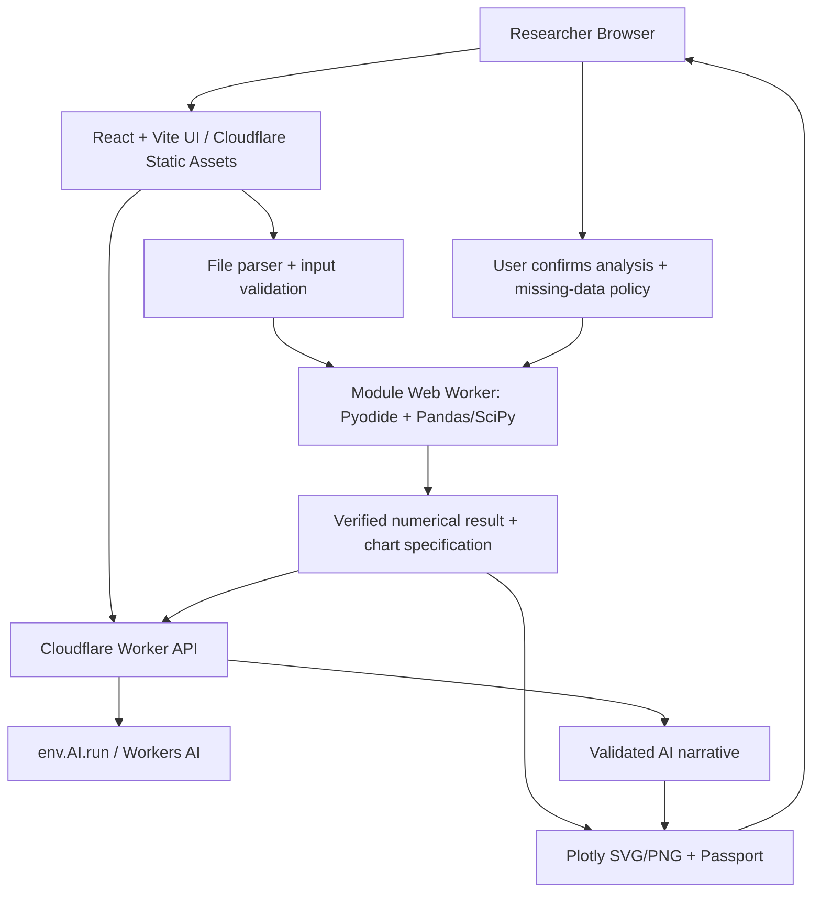

# ARCHITECTURE.md — Cloudflare-native MVP

## Architecture in one diagram

## Trust boundaries
- **Browser (untrusted input)**: holds original CSV in memory, performs numerical analysis in a dedicated Web Worker. No arbitrary Python prompt execution.
- **Cloudflare Worker**: handles small, validated JSON requests, model inference, rate limiting and consistent errors. It **does not receive the original file**.
- **Cloudflare Workers AI**: sees the approved goal, selected variable names (sanitized) and compact numerical summary / notes, not individual participant rows.
- **Optional D1/R2**: phase 2 only after auth/security reviews and documented retention policy.

## Why not FastAPI on plain Workers?
Regular Cloudflare Workers are not a drop-in hosting environment for arbitrary Linux Python/Pandas/SciPy FastAPI workloads. Cloudflare Python Workers use Pyodide with runtime constraints; Cloudflare Containers can host full Python services but require paid Workers. Browser Pyodide is the simplest cost-aware proof of concept.

## Components and responsibilities
1. `src/components/`: user interface; no raw model calls.
2. `src/workers/analysis.worker.ts`: loads pinned Pyodide release and requested vetted packages lazily, posts typed messages/results, reports initialization status.
3. `src/python/engine.py`: reviewed fixed functions (`profile_dataset`, `descriptive`, `welch_two_group`, `pearson_two_variable`). No `exec`/`eval` of user content.
4. `src/lib/contracts.ts`: Zod schemas and TypeScript types; same constraints as `schemas/`.
5. `worker/index.ts`: routes `/api/health`, `/api/ai/plan`, `/api/ai/interpret`; JSON validation, inference, safe errors.
6. `src/lib/report.ts`: provenance and export packaging. All reported numbers linked to immutable analysis result.

## Sequence
1. User selects file. Validate size/type; parse into in-browser table.
2. Python profiles columns and data quality. User confirms choices.
3. Optional Worker AI request proposes method from closed allowlist; return schema-validated plan, not code.
4. User approves. Fixed Python handler calculates, produces result JSON and warnings.
5. Browser constructs figure specification; user modifies labels/styles only.
6. Optional Worker AI receives sanitized numeric output and writes JSON narrative, validated and checked for numerical claims.
7. Browser exports chart and Evidence Passport; UI never reports export success until file generated.

## Non-negotiable performance bounds
- Max CSV 5 MB, 10,000 rows and 40 columns for first iteration; any supported sizes must be benchmarked on target laptop/browser.
- Initial Pyodide spinner with graceful failure; initialization timeout and worker recreation.
- No full raw datasets in model context. Trim user goals to 1000 chars and summaries to 12 KB JSON for initial build.
- Inference rate limit and same-origin request policy; protect free AI quota.

## Later production architecture
Replace browser Pyodide with a FastAPI service inside Cloudflare Containers if client memory/performance limits become a real issue. Frontend/Worker contracts should remain stable so compute backend can change independently. Add auth and storage only when user requirements justify complexity.
